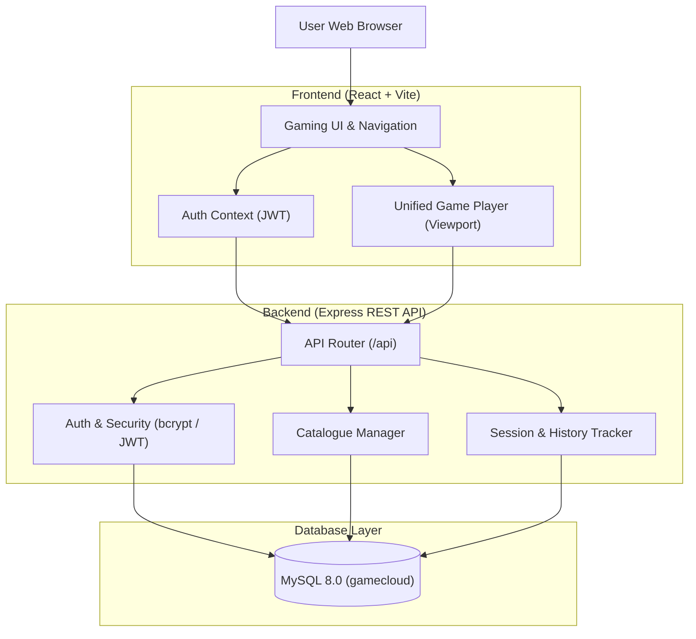

# GameCloud — System Architecture

## 1. Architectural Overview

GameCloud is structured according to a modern multi-tier decoupled architecture:
1. **Client Tier**: User's web browser rendering React 18, HTML5 Canvas, WebGL, and Three.js viewports.
2. **Frontend Tier (Vite + React)**: Single Page Application (SPA) managing routing, state, game lifecycle, and session heartbeats.
3. **Backend Tier (Express.js)**: RESTful API server handling authentication, game catalogue CRUD, session recording, and role verification.
4. **Data Tier (MySQL 8.0)**: Relational database storing user credentials (bcrypt), session durations, game metadata, and favourites.
5. **Execution Tier (Dual Mode Engine)**:
   - **Mode 1 (Active)**: In-browser execution via WebGL & Canvas.
   - **Mode 2 (Prepared Blueprint)**: Containerized game rendering and WebRTC streaming.

---

## 2. Component Breakdown

### A. Frontend Layer
- **Tech Stack**: React 18, Vite 5, Tailwind CSS, Lucide React, Three.js 0.164.
- **Routing**: `react-router-dom` v6 with client-side history, public routes, and `ProtectedRoute` guards for user dashboard and admin panels.
- **State Management**: React Context (`AuthContext`) maintaining authentication tokens, user profile, and automatic heartbeat refresh.

### B. Backend Layer
- **Tech Stack**: Node.js v22, Express.js 4, `mysql2/promise`, `jsonwebtoken`, `bcryptjs`, `cors`, `helmet`, `morgan`.
- **Security**:
  - Salting and hashing passwords via `bcryptjs` (work factor 10).
  - Stateless JWT authorization with 7-day expiration.
  - Role-based access control middleware (`roleMiddleware('admin')`).
  - Parameterized SQL queries to eliminate SQL injection vulnerabilities.
  - Helmet headers configured to allow cross-origin game iframes.

### C. Database Layer
- Normalised relational schema in MySQL 8.0 with InnoDB foreign key constraints and `ON DELETE CASCADE`.
- Idempotent migration script (`database/setup.js`) supporting automated creation and initial seeding.
