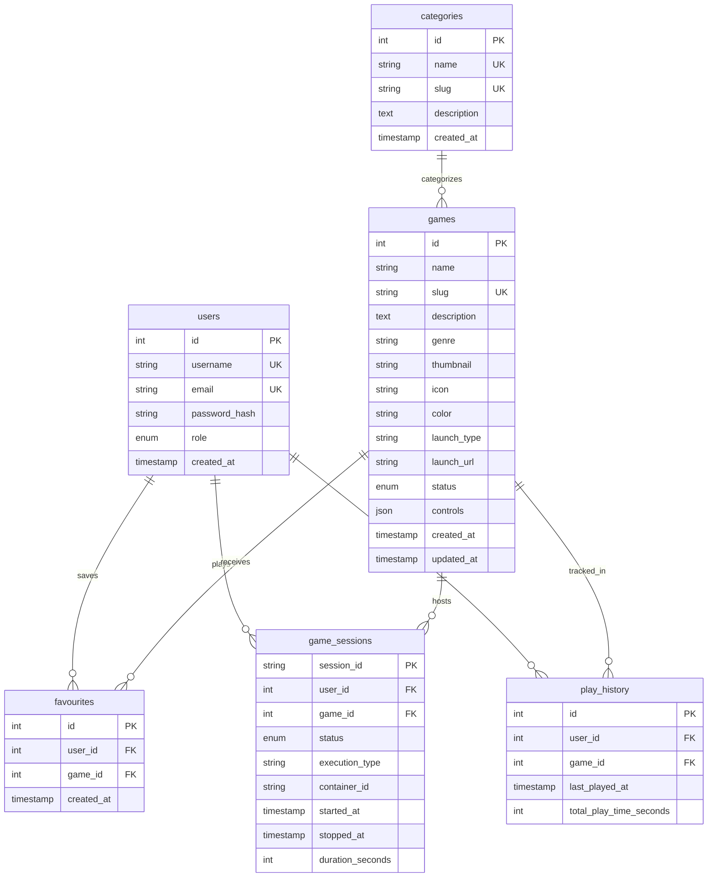

# GameCloud — Database Specification

## 1. Overview

Database Engine: **MySQL 8.0**  
Character Set: `utf8mb4`  
Collation: `utf8mb4_unicode_ci`  
Database Name: `gamecloud`

---

## 2. Entity-Relationship Diagram (ERD)

---

## 3. Table Details

1. **`users`**:
   - Stores user credentials, email, and platform role (`user` or `admin`).
2. **`categories`**:
   - Stores game genres (Racing, Puzzle, Action, Sandbox, Arcade).
3. **`games`**:
   - Stores game metadata, launch type (`browser_canvas`, `browser_webgl`, `browser_wasm`, `remote_container`), launch URL, availability status (`playable`, `coming_soon`, `experimental`), and keyboard controls JSON.
4. **`favourites`**:
   - Relates user IDs to game IDs with a unique constraint `(user_id, game_id)`.
5. **`game_sessions`**:
   - Primary key is a unique session token (`sess_<timestamp>_<random>`). Tracks start timestamp, stop timestamp, and duration.
6. **`play_history`**:
   - Aggregates total play time per game per user, updating on session conclusion.
