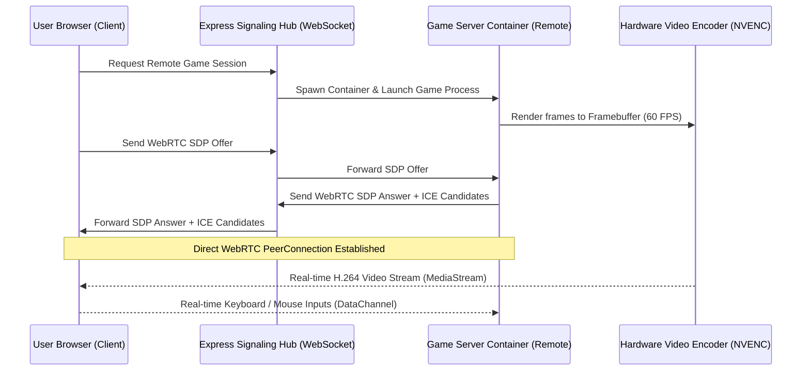

# GameCloud — WebRTC Remote Streaming Architecture Blueprint

## 1. Overview & Motivation

For complex 3D titles (e.g. OpenArena, SuperTuxKart native builds) that exceed browser WebAssembly capabilities, GameCloud specifies a **Mode 2 Remote Streaming Architecture**.

In Mode 2:
- The game executes inside a GPU-accelerated server environment (e.g. Linux container with NVENC/VAAPI or Windows Host).
- The video frames are captured directly from the virtual framebuffer (X11 / Wayland / DXGI).
- Video frames are hardware-encoded (H.264 / VP9 / AV1) and streamed to the user's browser via **WebRTC**.
- User inputs (keyboard, mouse, gamepad) are sent to the game process with sub-10ms latency via **WebRTC DataChannels**.

---

## 2. End-to-End Pipeline

---

## 3. Core Technical Components

### A. Video Capture & Encoding
- **Windows**: Desktop Duplication API (DXGI) capturing raw DirectX buffers, encoded via NVIDIA NVENC or Intel QuickSync.
- **Linux Containers**: Headless Xorg / `xvfb` capturing OpenGL framebuffers, encoded with GStreamer or FFmpeg (`nvh264enc` / `vaapih264enc`).

### B. Low Latency WebRTC Transport
- **Signaling**: WebSocket signaling server exchanging Session Description Protocol (SDP) and Interactive Connectivity Establishment (ICE) candidates.
- **STUN/TURN**: NAT traversal using Google STUN (`stun:stun.l.google.com:19302`) and Coturn for relay fallback.
- **Jitter Buffer**: Ultra-low-latency jitter buffer tuned to 0-1 frames.

### C. Input Forwarding
- Browser captures `keydown`, `keyup`, and `mousemove` events (with Pointer Lock API).
- Binary or compact JSON payloads sent via WebRTC `RTCDataChannel` (ordered: false, maxRetransmits: 0) to avoid TCP head-of-line blocking.
- Virtual input driver on host (`uinput` on Linux or `SendInput` on Windows) forwards events directly to the game process.
